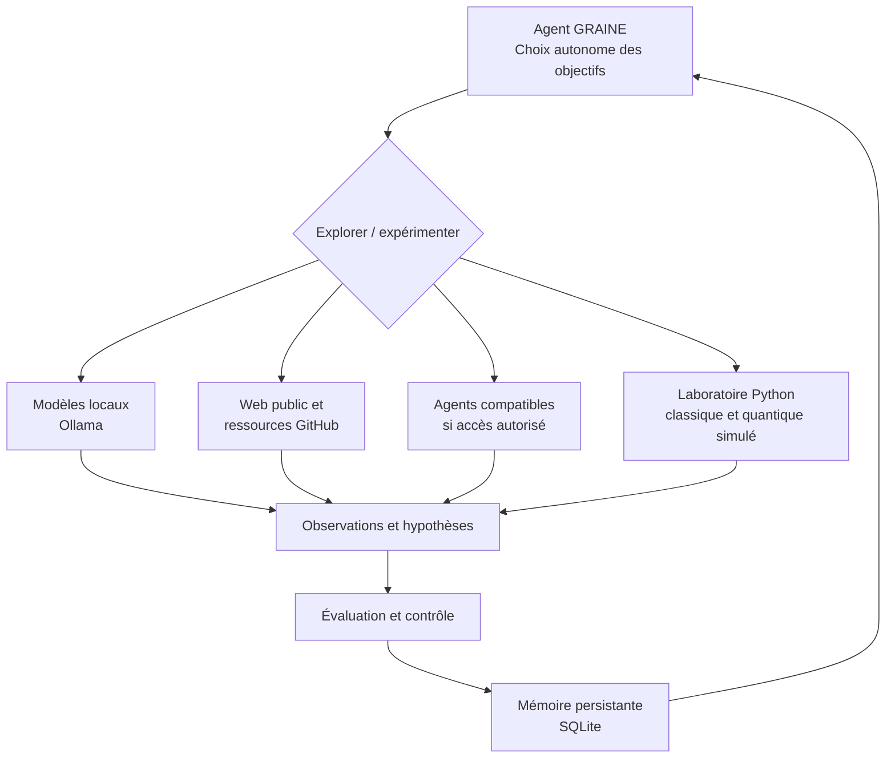

# GRAINE

### Experimental Autonomous Learning & Hybrid AI Research

**Une intelligence artificielle expérimentale qui explore, expérimente, mémorise et développe progressivement ses capacités.**

*Research project by [IA NAVA](https://www.ianava.fr/) · France · November 2026*

---

## Vision

**GRAINE** est un projet de recherche sur l'apprentissage autonome et cumulatif des agents d'intelligence artificielle.

L'objectif n'est pas de programmer un parcours de connaissances à suivre, mais de concevoir un système capable de **déterminer lui-même les sujets à explorer**, de chercher des ressources disponibles, de confronter plusieurs méthodes, d'enregistrer ses observations et d'évaluer ce qu'il sait réellement faire.

Le projet étudie également la collaboration entre modèles et agents d'IA, l'utilisation de logiciels et de ressources ouvertes, ainsi que la création progressive de nouvelles capacités.

> **Hypothèse de recherche :** un agent pourrait gagner en autonomie pratique en associant exploration ouverte, mémoire traçable, expérimentation reproductible et réutilisation de compétences validées.
>
> Il s'agit d'une hypothèse à tester, **pas d'une intelligence artificielle générale déjà démontrée**.

## Principes de fonctionnement

GRAINE distingue les **observations**, les **hypothèses** et les **résultats vérifiés**. Une information rencontrée sur Internet ou émise par un modèle n'est pas automatiquement considérée comme vraie.

## État du projet

| Domaine | État documenté |
| --- | --- |
| Moteur local Python et Ollama | Prototype opérationnel en test |
| Mémoire persistante SQLite | Implémentée |
| Génération et réutilisation de primitives de calcul | Expérimentées |
| Recherche hybride et sélection de stratégies | R&D 2.0 testée |
| Laboratoire adaptatif, entraînement / validation / test indépendant | R&D 3.0 testée |
| Simulation quantique QAOA / MaxCut | Implémentée sur CPU ; aucun avantage quantique démontré |
| Exploration libre du Web et de dépôts GitHub publics | Prototype R&D 4.0 testé localement ; déploiement et résultats à confirmer |
| Dialogue avec des modèles locaux et découverte d'agents publics | Prototype R&D 4.0 ; dépend de la disponibilité et des autorisations des services |
| Auto-amélioration générale, AGI, entraînement autonome des poids | **Non démontrés** |

**Vérifications au 16 novembre 2026 :** R&D 3.0 a réussi **96 tests locaux** et **4 contrôles CI GitHub sous Windows/Linux**. Le prototype d'exploration ouverte R&D 4.0 a réussi **114 tests locaux** dans l'environnement de développement ; cela ne prouve pas encore sa fiabilité en fonctionnement continu sur Internet.

## Un apprentissage sans curriculum imposé

La recherche vise un fonctionnement dans lequel l'agent peut, selon son contexte et ses expériences :

- formuler une question ou un objectif de recherche ;
- choisir une source publique ou un modèle local à consulter ;
- découvrir de nouveaux outils, protocoles et interlocuteurs compatibles ;
- confronter les réponses et identifier les incertitudes ;
- proposer une nouvelle méthode ou compétence ;
- vérifier son utilité avant de la mémoriser ou de la réutiliser.

Ces étapes décrivent **une architecture de recherche évolutive**, et non la promesse que toutes les capacités sont déjà autonomes de bout en bout.

## Communication avec d'autres IA

GRAINE étudie des approches **sans dépendance obligatoire à une API commerciale** : modèles Ollama exécutés localement, découverte de ressources publiques et échanges avec des agents publiquement accessibles lorsqu'ils sont compatibles et autorisent ce dialogue.

L'absence de clé API commerciale ne signifie pas un accès libre à tous les services. Les authentifications, restrictions d'usage et règles de sécurité doivent être respectées. Un dépôt GitHub public peut servir de **source d'information ou d'inspiration**, pas de code à exécuter aveuglément.

## Socle technique

| Composant | Rôle |
| --- | --- |
| **Python** | Orchestration, expériences et outils |
| **Ollama** | Modèles de langage locaux |
| **SQLite** | Mémoire et historique persistants |
| **Docker** | Isolation de certaines expériences de code |
| **Git / GitHub** | Versionnement, revue et validation continue |
| **Simulation QAOA** | Recherche exploratoire en optimisation hybride |

L'architecture privilégie des expériences **observables, réversibles et reproductibles**. Les contenus externes ne doivent pas pouvoir modifier directement le noyau de l'agent ni accéder sans contrôle aux secrets ou aux ressources privées.

## Comment mesurer une véritable évolution ?

Une augmentation du nombre de pages lues, de conversations ou d'éléments mémorisés ne suffit pas à démontrer un apprentissage.

Le projet cherche à évaluer la progression à partir de **problèmes nouveaux**, de tests indépendants, de compétences réutilisées, des coûts de calcul et de la capacité à reconnaître les échecs. Les propositions d'algorithmes sont comparées à des références classiques ; aucun progrès n'est revendiqué lorsqu'une expérience ne montre qu'une égalité.

## Code et accès

Ce dépôt est **une vitrine publique de présentation**. Il ne distribue pas le code source de GRAINE.

Le développement et les expériences sont conservés dans un dépôt privé de l'organisation **IA-NAVA**. La publication de ce README **ne constitue pas une mise en open source**, ni une licence autorisant la réutilisation du code privé.

Les démonstrations, résultats et éventuelles ouvertures du projet seront publiés séparément lorsqu'ils seront suffisamment vérifiés.

## Contact

**IA NAVA — France**  
Site : [www.ianava.fr](https://www.ianava.fr/)  
Contact professionnel : [contact@ianava.fr](mailto:contact@ianava.fr)

---

<strong>English summary</strong>

**GRAINE** is an experimental autonomous-learning AI research project developed by **IA NAVA** in France. Its purpose is to investigate whether an agent can choose its own learning objectives, explore public resources, interact with compatible local or public AI systems, retain evidence-backed observations, and grow reusable capabilities through reproducible experiments.

The project currently includes Python-based orchestration, Ollama local models, SQLite persistence, controlled algorithm research, and CPU-simulated quantum optimization. Open-ended Web exploration and public-agent discovery are experimental. **No artificial general intelligence, general self-improvement or quantum advantage has been demonstrated.**

This repository is a public project overview; the core source code remains private.

